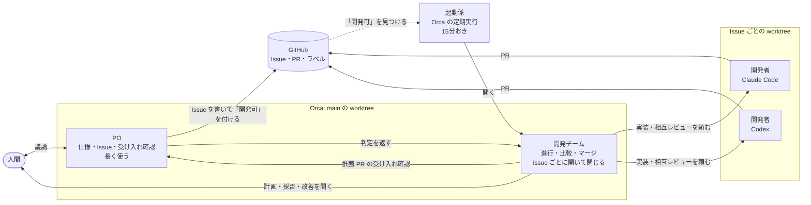
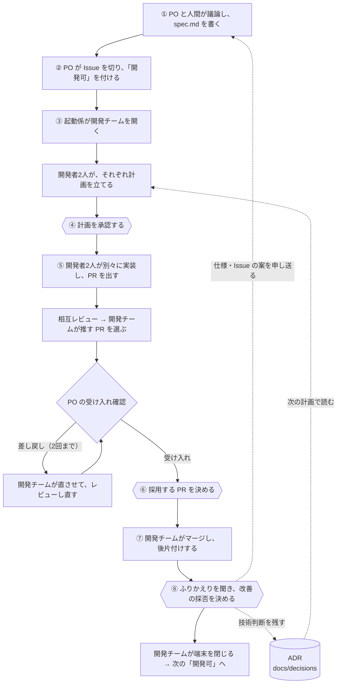

# Overstrata Board

TRPG「Overstrata」のプレイ中に使う戦闘ボード（Web アプリ）です。戦場のマス目・キャラの位置・移動できる範囲を画面に出します。

- 目標: GM とプレイヤーが、それぞれの端末で同じ盤面を見て操作できること
- 最初の形: 1台のスマホで誰か1人が操作し、画面を見せる
- ルールは強制しません。補助として見せるだけです

## 開発の仕組み

このアプリは、人間が判断し、AI エージェントが仕様づくりから実装・レビュー・マージまでを進める形で作っています。エージェントは役割の違う3つの席に分かれ、Orca（複数の AI エージェントの端末と worktree をまとめて扱うアプリ）の上で動きます。詳しくは [docs/workflow.md](docs/workflow.md)「3つの席」を見てください。

### 席と受け渡し



| 席 | 担当 | 今のエージェント |
|---|---|---|
| PO | 人間と議論して `spec.md` と Issue を書き、着手してよい Issue に「開発可」を付ける。開発チームが推す PR を、受け入れ条件・仕様・使う人の目で確かめる（コードは見ない） | Codex |
| 開発チーム | 1つの Issue を最後まで進める。開発者2人に同じ Issue を別々に実装させ、互いにレビューさせて、どちらを採るかを推す。マージ・後片付け・ふりかえりのあと、自分の端末を閉じる | Claude Code（Opus） |
| 開発者 | 自分の worktree で計画・実装・PR・レビューを行う | Claude Code と Codex が1人ずつ |
| 起動係 | 「開発可」の Issue があり、動いている開発チームがいないときだけ、開発チームを開く（同時に1つまで） | Orca の定期実行 |

### Issue 1本の流れ

六角形が人間の判断です。それ以外はエージェントが進めます。



人間がすることは、PO との議論と、④⑥⑧の3つの判断です。記録は GitHub（Issue・PR・コメント）と、`docs/issue-reports/` の Issue レポートに残ります。Issue を越えて効く技術の判断は、⑧で人間が採用したものだけを `docs/decisions/` に ADR として残し、次の Issue の計画で読みます。

## ドキュメント

- [docs/spec.md](docs/spec.md) — 仕様（何を・なぜ・どこまで）
- [docs/workflow.md](docs/workflow.md) — 開発の進め方（Spec × Issue × Orca）
- [docs/testing.md](docs/testing.md) — テストの分担・TDD・モック・PR レビューの方針
- [docs/next-issues.md](docs/next-issues.md) — 現在地と、次に切る Issue の下書き
- [docs/issue-reports/](docs/issue-reports/README.md) — Issue ごとの計画・実装・レビュー・採用判断と改善の記録
- [docs/decisions/](docs/decisions/README.md) — Issue を越えて効く技術判断の記録（ADR）
- [CLAUDE.md](CLAUDE.md) / [AGENTS.md](AGENTS.md) — AI エージェント向けガイド

## 技術方針

- Vite + React + TypeScript
- テストは Vitest と Playwright（Chromium）、CI は GitHub Actions
- 開発も本番も Docker コンテナで動かす（OrbStack などの互換ランタイムでもよい）
- ルール計算は `src/domain/` の純粋関数にまとめる
- 盤面の描画は、まず CSS Grid で行う
- サーバーやデータベースは、共有・保存機能が必要になるまで導入しない

## 開発

### コンテナで動かす（おすすめ）

Docker（OrbStack などの互換ランタイムでもよい）があれば、ホストに Node は要りません。

```sh
docker compose up            # 開発サーバーを起動 → http://localhost:5173
docker compose down          # 止める（コンテナを削除する）
docker compose down -v       # node_modules のボリュームも消して止める
```

`docker compose up` を Ctrl+C で止めた場合も、コンテナを片付けるときは `docker compose down` を実行します。

テスト・型チェック・Lint・ビルドもコンテナの中で実行できます。

```sh
docker compose run --rm app npm run test
docker compose run --rm app npm run typecheck
docker compose run --rm app npm run lint
docker compose run --rm app npm run build
docker compose run --rm app npm run test:mutation   # ミューテーションテスト（下記）
# 開発サーバーを起動中なら exec でもよい: docker compose exec app npm run test
```

- `node_modules` はコンテナ専用のボリュームに入ります。`package-lock.json` が変わると、起動時に自動で `npm ci` し直します
- ファイルを変えても画面が更新されないときは、`.env` に `WATCH_POLLING=1` を書きます

### スマホ実機から開く

開発サーバーは、同じ LAN の端末からも開けるように公開しています。スマホの実機で画面を確かめるためです（[docs/spec.md](docs/spec.md)「2.4 画面の前提」）。

- スマホをホストと同じ Wi-Fi につなぎ、`http://<ホストの LAN 内の IP アドレス>:5173`（`HOST_PORT` を変えたときはその番号）を開きます
- 同じ LAN の誰からでも開けます。カフェなど信頼できないネットワークでは起動しないでください

### 複数の worktree で同時に起動する

worktree ごとに `.env.example` を `.env` にコピーし、ポートとプロジェクト名を変えます（`.env` はコミットしません）。

```sh
# 例: 2つ目の worktree の .env
HOST_PORT=5174
COMPOSE_PROJECT_NAME=overstrata-board-issue-2
```

`HOST_PORT` を変えると、ホスト側のポートがぶつかりません。`COMPOSE_PROJECT_NAME` を変えると、コンテナとボリュームが worktree ごとに分かれます（既定ではディレクトリ名から決まります）。

### ホストで動かす

Node 24 が必要です（`.nvmrc`）。

```sh
npm ci
npm run dev        # 開発サーバー
npm run test       # テスト（Vitest）
npm run typecheck  # 型チェック
npm run lint       # Lint（ESLint）
npm run build      # ビルド（dist/ に出力）
npm run test:mutation  # ミューテーションテスト（下記）
```

### E2E（Playwright）

実際の Chromium でアプリを開き、見出し「Overstrata 戦闘ボード」と未処理の JavaScript 例外がないことに加え、10×10の盤面・数字の座標ラベル・マスの選択／切替／解除・余白タップでの選択維持、サンプル4体の表示・キャラの選択／別キャラへの切替・範囲内外への移動・解除を375×667px・1280×720pxで確認します。マスが正方形であること、盤面全体が画面内にあり横スクロールが出ないことも確認します。モックは使いません。スマホ実機の指での使いやすさは、レビュー時に人間が別途確認します。

#### Docker だけで実行（ホストの Node・ブラウザは不要）

クリーンな checkout のルートで、Docker Compose が使える状態から実行します。初回はイメージ・依存・Chromium を取得するため時間がかかります。

```sh
sh scripts/e2e.sh --docker
```

アプリは現在の checkout を本番イメージにビルドし、nginx コンテナで配信します。runner は Node 24 / Debian 12（`node:24-bookworm`）で、lockfile に固定した `@playwright/test` 1.64.1 の CLI が対応する Chromium と OS 依存を導入します。既存の Alpine 開発コンテナにはブラウザを入れません（[対応 OS](https://playwright.dev/docs/intro#system-requirements)、[Docker 構成](https://playwright.dev/docs/docker#build-your-own-image)）。更新時も lockfile の更新後に runner を再ビルドすることで版を揃えます。

#### ホストから実行（macOS / Linux）

Docker に加え、`.nvmrc` の Node 24 と Playwright 対応 OS が必要です。macOS 14 以降、または対応する Debian / Ubuntu を使ってください。

```sh
# 初回・lockfile 更新時（nvm を使う場合は先に nvm use）
npm ci
npx playwright install chromium
# Linux では OS 依存も必要: npx playwright install --with-deps chromium

# 以後の実行入口（アプリ配信は Docker）
npm run test:e2e
# 対象を絞る例
npm run test:e2e -- --project=chromium-mobile
```

どちらの経路もアプリのビルド、新規コンテナの起動、healthcheck の準備待機、テスト、後片付けまで行います。Docker runner 内でも `npm run test:e2e` を実行しますが、内部フラグ `E2E_IN_CONTAINER=1` により Playwright だけを起動します。利用者はこのフラグや `E2E_BASE_URL` を設定しません。再試行は0回で、失敗を終了コードに反映します。

#### worktree・並行実行と後片付け

実行ごとに一意な Compose project と `e2e-artifacts/run-*/` を作ります。ホスト向けポートは Docker が空いている番号を loopback に割り当て、コンテナの実際のポートから接続先を取得します。`.env` の開発用 `HOST_PORT` / `COMPOSE_PROJECT_NAME` や起動済みサーバーは再利用しません。同じ worktree 内で並行実行しても出力を上書きしません。

成功・失敗・通常の中断（Ctrl+C）では、その実行のコンテナ・ネットワーク・イメージを削除します。runner は実行固有の名前で管理し、起動処理と停止・削除の完了を待ってからネットワークとイメージを片付けます。既知の資源の残存や検査の失敗は非ゼロ終了と復旧コマンドで知らせます。Docker のビルドキャッシュと調査材料は残します。強制終了や Docker 停止により後片付けに失敗した場合だけ、表示された結果ディレクトリを指定して再実行してください。他の worktree の project に対する操作や全体の prune は不要です。

```sh
# run-XXXXXXXX は実行時に表示されたディレクトリ名に置き換える
export E2E_ARTIFACT_DIR="$PWD/e2e-artifacts/run-XXXXXXXX"
project=$(cat "$E2E_ARTIFACT_DIR/project.txt")
docker rm -f "$project-runner" # 存在しない場合は続行
docker compose -p "$project" -f compose.e2e.yaml down --volumes --rmi local
unset E2E_ARTIFACT_DIR
```

後片付けの回帰テストは `npm run test` に含まれます。Docker CLI の境界を fake に置き換え、起動中の中断、終了コードの伝播、削除・照会の失敗、`down` が成功扱いでも残る資源の検出を確認します。実際の Docker と Chromium の確認は上記 E2E で行います。

#### 結果・失敗の調べ方

実行終了時に表示された `e2e-artifacts/run-*/` に次を保存します。生成物は Git・Docker build context・Lint から除外します。

- `report/index.html`: HTML report（実行環境・pageerror の添付を含む）
- `test-results/`: 失敗時の `trace.zip`・スクリーンショット・エラーの状況
- `build.log` / `app.log` / `cleanup.log`: ビルド・アプリ・終了処理のログ
- `project.txt`: その実行の Compose project 名

```sh
# ホストに Node の準備がある場合
npx playwright show-report e2e-artifacts/run-XXXXXXXX/report
# trace 単体は npx playwright show-trace <trace.zip のパス>

# Docker のみでもレポートを閲覧できる（http://localhost:9323）
# 競合するときは9323を変更。閲覧後はCtrl+Cでこのコンテナを削除。
docker run --rm -p 127.0.0.1:9323:80 \
  -v "$PWD/e2e-artifacts/run-XXXXXXXX/report:/usr/share/nginx/html:ro" nginx:1.29-alpine
```

HTML report の失敗テストから trace を開き、操作・DOM・通信・エラーを調べます。CI では実行ページの artifact をダウンロードして展開し、同じ `run-*/report` と `test-results` を使います。テスト開始前のビルド・起動失敗では trace は作られないので、Actions のログと `build.log` / `app.log` を確認します。

失敗検出を確認するときは、`e2e/smoke.spec.ts` の期待する見出しを一時的に存在しない文字列へ変更し、非ゼロ終了と HTML report・trace・スクリーンショットの生成を確認します。CI でも検証する場合は作業ブランチにその一時変更を push し、失敗した job と artifact を確認してください。必ず期待値を戻してローカルと CI を再実行し、最終コミットの成功を記録します。

### ミューテーションテスト（StrykerJS）

実装の比較演算子や条件式などを一時的に変え（変異）、既存のテストがその誤りを検出できるかを確かめます。方針・結果の分類は [docs/testing.md 7章](docs/testing.md#7-ミューテーションテスト)を参照してください。

```sh
npm run test:mutation                               # ホスト（Node 24）
docker compose run --rm app npm run test:mutation   # 開発コンテナ
```

1回の実行で次を順に行い、どこで失敗しても非ゼロで終了します。

1. 通常テスト（`npm run test`）
2. Stryker の互換処理（下記）
3. Stryker の初期実行（変異なしで既存の Vitest・React Testing Library のテストを全件実行）と、変異ごとのテスト実行。型として成立しない変異は TypeScript の検査で `CompileError` に分けます
4. JSON レポートの検証。対象ファイルの欠落・変異0件・テストで検証された変異0件・テストが1件も実行されないままの `Survived`・`Pending` は失敗にします

- **対象**は `stryker.config.mjs` の `mutate` に明示した9ファイル（距離・移動力・移動範囲、移動力の定数、座標変換・盤面座標、盤面サイズ、マス・キャラの選択表示と座標ラベルの部品、選択の状態変化と移動・未配置の駒の配置、駒の数・用意・確定、駒の準備の定数、数の入力・未配置一覧・確定とやり直しの画面部品）です。除外の理由も同じファイルに書いています。Playwright は変異ごとには実行しません
- **並列度**は `concurrency: 2` に固定しています。所要時間は1分前後です（2026-10-17、Apple Silicon のホストで約53秒）
- **スコアで不合格にはしません**（`thresholds.break: null`）。`Survived` / `NoCoverage` は1件ずつ分類します
- 標準の変異には数値リテラルを変える種類がないため、`5` や `10` などの数値そのものは変異しません

#### 結果の読み方と生成物

| 場所 | 内容 |
|---|---|
| `reports/mutation/mutation.html` | 最新の HTML レポート。ファイルごとに変異の位置・内容・状態と、検出したテスト（Killed の行の Tests）を確認できる |
| `reports/mutation/mutation.json` | 最新の JSON レポート（同じ内容） |
| `mutation-artifacts/run-*/` | 実行ごとの記録。`run.log`（通常テスト・互換処理・Stryker の出力と各段階の所要時間）、`summary.md`（状態別件数・Survived/NoCoverage・失敗の理由）、`stryker.log`、`mutation/`（その実行のレポート）。次の実行でも消えない |

状態は、`Killed`（テストが失敗＝検出）と `Timeout`（無限ループ等で時間切れ。Stryker は検出に数えるが別に報告する）を分けて読みます。`CompileError` / `RuntimeError` / `Ignored` は検出に数えません。要約のスコアは Stryker と同じ（Killed+Timeout）÷（Killed+Timeout+Survived+NoCoverage）で、Killed だけの割合も並べて出します。

生成物は Git・Docker build context・Lint から除外しています。片付けるときは次を実行します（他の worktree には影響しません）。

```sh
rm -rf reports/mutation mutation-artifacts .stryker-tmp stryker.log
```

`.stryker-tmp/` は Stryker が変異させたコピーを置く作業場所で、正常終了時は自動で消えます。強制終了した場合は、ルートに `stryker-setup-*.js` が残ることもあるので一緒に消してください。

#### Stryker の互換処理と外す手順

StrykerJS 10.0.0 は Vitest 5 と次の2点で正しく動かないため、`scripts/stryker-compat.mjs` が実行のたびに、この checkout の `node_modules` 内の3ファイルだけを書き換えます。

| 上流 | 症状 | 書き換え |
|---|---|---|
| [stryker-js#6210](https://github.com/stryker-mutator/stryker-js/issues/6210)（修正 PR [#6214](https://github.com/stryker-mutator/stryker-js/pull/6214)） | 変異ごとの実行でテストが1件も選ばれず、全変異が `Survived` のまま正常終了する | `@stryker-mutator/vitest-runner` の `test-helpers.js`・`stryker-setup.js` のテスト名の区切りを Vitest 5 と同じ `' > '` にする |
| [stryker-js#6208](https://github.com/stryker-mutator/stryker-js/issues/6208)・[#6227](https://github.com/stryker-mutator/stryker-js/issues/6227) | `{ ... } as const` の中が変異されず、`src/data/movement.ts` がレポートから消える | `@stryker-mutator/instrumenter` の `syntax-helpers.js` で、`as` 式の型の部分だけを飛ばす |

- `@stryker-mutator/vitest-runner`・`@stryker-mutator/instrumenter` が 10.0.0、`vitest` が 5 系で、置き換える前の文字列がそれぞれ1か所だけある場合に適用します。適用済みなら何もしません。版と3ファイルすべての内容を確かめてから書き込むので、版が違うときや、どれか1ファイルでも内容が想定と違うときは、どのファイルも書き換えずに失敗します（書き込みの途中でディスク障害などが起きた場合に、全ファイルがそろって戻ることまでは保証しません）
- `npm ci` で `node_modules` を入れ直すと元に戻りますが、`npm run test:mutation` が毎回適用するので手順は不要です（ホスト・開発コンテナのボリューム・CI で同じ）

上流の修正版へ更新すると、この版の照合で失敗します。そのときは `scripts/stryker-compat.mjs` の該当する書き換えを外して `npm run test:mutation` を実行し、次を確かめてから削除します。変異の件数が以前と同じことは求めません。

1. ログの `Ran N tests per mutant` が0でなく、テストが実行されないままの `Survived` が無い
2. `mutate` の全ファイルがレポートにあり、`src/data/movement.ts` の装備補正の符号を変えた変異が `getMovement` のテストで Killed になる
3. HTML レポートで、型注釈・`as const` などの型の部分が変異されていない

### 本番用イメージ

ビルド済みのファイルを nginx で配信するイメージです。

```sh
docker build --target prod -t overstrata-board .
docker run --rm -p 8080:80 overstrata-board   # → http://localhost:8080
```

### CI

PR を作ったときと main への push のときに、GitHub Actions（`.github/workflows/ci.yml`）が次を実行します。

- テスト・型チェック・Lint・ビルド
- 本番用イメージのビルド
- Docker で Chromium E2E（幅375px・1280px）。失敗は CI の失敗となり、Actions の実行ページから `e2e-<run ID>-<attempt>` artifact を取得できます（保存14日）
- ミューテーションテスト（`npm run test:mutation`）。通常テスト・互換処理・Stryker・結果の検証の失敗は CI の失敗になります。スコアでは失敗にしません。状態別件数は Job Summary に、`mutation-artifacts/` の記録は成功・失敗にかかわらず `mutation-<run ID>-<attempt>` artifact に保存します（保存14日）
